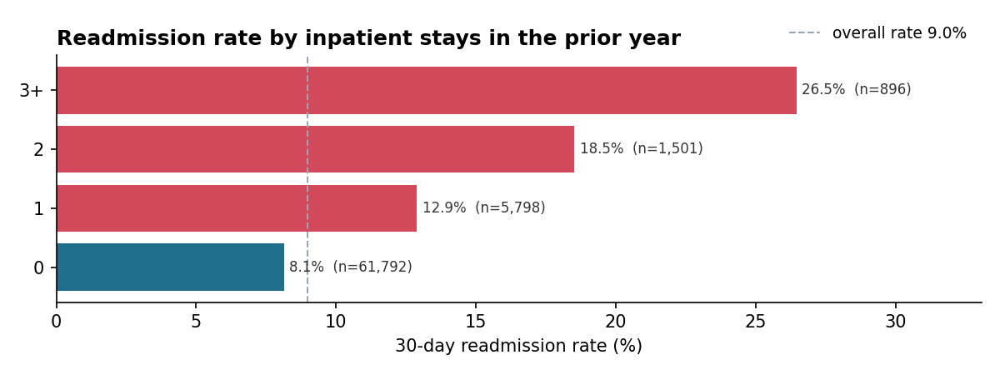
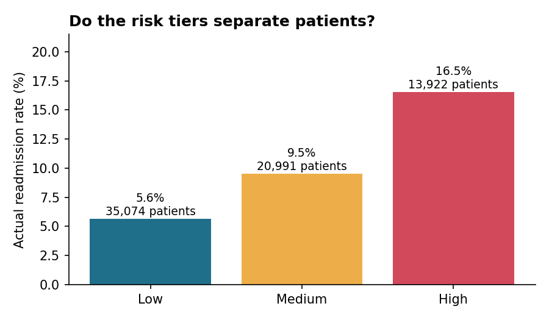

# 30-Day Readmission Risk Dashboard

**Which diabetic patients are most likely to come back to the hospital within 30 days, and who should a care manager call first?**

Hospitals with too many 30-day readmissions lose Medicare payments under the CMS Hospital Readmissions Reduction Program. This project takes about 100,000 de-identified hospital stays, finds what drives readmission, scores each patient's risk, and puts it all in a dashboard a care team could use every morning.

I ran it as a four-sprint agile project, with a backlog, user stories, and a retrospective after each sprint. The full backlog is in [docs/agile_backlog.md](docs/agile_backlog.md).

---

## Key findings

After cleaning, the data covers **69,987 patients** with a **9.0% 30-day readmission rate**.

1. **Repeat hospital users are the clearest high-risk group.** Patients with 3+ inpatient stays in the past year were readmitted at 26.5%, more than three times the 8.1% rate for patients with no prior stays.
2. **Where patients go after discharge matters as much as their history.** Patients discharged to a skilled nursing or other care facility were readmitted at 15.4%, twice the 7.7% rate for everyone else. In the model, discharges to rehab facilities and psychiatric hospitals carried the highest risk of any factor.
3. **Diagnosis matters less than expected.** No primary diagnosis group was more than 1.2x the overall rate. Who the patient is and where they go next say more than why they were admitted.
4. **The risk score finds the right people.** The high tier readmits at 16.5%, nearly three times the low tier's 5.6%. Calling the top 20% of patients by score catches 37% of all readmissions, 1.9x better than picking the same number at random.





## Recommendation

Add two questions to every discharge: *Was this patient in the hospital in the past year?* and *Are they going to a facility instead of home?* A yes to either should trigger a follow-up call. For facility discharges, the call should go to the receiving facility too, since a clean handoff is where those readmissions are most likely to be prevented.

**Model accuracy:** ROC AUC of 0.648 on 17,497 held-out patients. That's typical for readmission models built on administrative data. Clinical notes and social factors like housing and transportation would likely push it higher.

---

## The dashboard

`streamlit run app.py` opens four tabs:

| Tab | Who it's for | What it does |
|---|---|---|
| Care manager worklist | Care managers | High-risk patients sorted by score, filterable by diagnosis and age, downloadable as CSV |
| Overview | Director of Quality | Readmission rate, high-risk count, and the analysis charts |
| Finance impact | Finance | Adjustable estimate of net savings if readmissions drop |
| About the model | Anyone checking the score | Accuracy, lift, and trade-offs in plain language |

---

## How it was built

| Sprint | Goal | Script | Output |
|---|---|---|---|
| 1 | Data foundation | `src/sprint1_data_foundation.py` | Data dictionary, quality report, clean table |
| 2 | Readmission analysis | `src/sprint2_analysis.py` | Rate charts, factor ranking, findings summary |
| 3 | Risk scoring | `src/sprint3_risk_model.py` | Logistic regression, risk tiers, driver chart |
| 4 | Dashboard and handoff | `app.py` | Streamlit dashboard |

## Healthcare data decisions

**De-identified data.** The UCI dataset has no names, dates of birth, or addresses, so it's safe to use publicly. With real patient data, this would run inside the hospital's secured environment under HIPAA, and the worklist export would need access controls.

**Who's excluded.** Patients who died or went to hospice were removed, since they can't be readmitted. Leaving them in would make the readmission rate look lower than it is.

**One stay per patient.** Many patients have several stays. I kept only the first one, because repeat stays from the same person aren't independent and would inflate the patterns.

**ICD-9 grouping.** Over 700 raw diagnosis codes were grouped into 9 categories (circulatory, respiratory, diabetes, and so on), following the grouping in the original research paper.

**Risk adjustment.** Raw readmission rates aren't fair comparisons between hospitals or units without accounting for how sick the patients are. This project compares patient groups, not hospitals, and the findings note that length of stay partly stands in for illness severity.

**Tiers sized to capacity.** The high-risk tier is the top 20% of scores, because that's roughly how many follow-up calls a care team can make. A purely statistical cutoff flagged over half of patients, which no team could act on.

**Why logistic regression.** A quality team has to explain the score to clinicians. A model with readable drivers is worth more here than a few points of extra accuracy from a black box.

---

## Run it yourself

```bash
git clone https://github.com/vamsikrishnachirumalla-sys/readmission-risk-dashboard.git
cd readmission-risk-dashboard
pip install -r requirements.txt

python src/sprint1_data_foundation.py   # downloads the UCI data on first run
python src/sprint2_analysis.py
python src/sprint3_risk_model.py
streamlit run app.py
```

If the automatic download fails, get `diabetic_data.csv` from the [UCI repository](https://archive.ics.uci.edu/dataset/296/diabetes+130-us+hospitals+for+years+1999-2008) and place it in `data/raw/`.

To try everything offline with fake data first:

```bash
python src/make_sample_data.py
```

## Project structure

```
readmission-risk-dashboard/
├── app.py                         Sprint 4 dashboard
├── src/
│   ├── config.py                  shared paths and settings
│   ├── make_sample_data.py        practice data generator
│   ├── sprint1_data_foundation.py
│   ├── sprint2_analysis.py
│   └── sprint3_risk_model.py
├── docs/agile_backlog.md          epics, user stories, sprint plan, retros
├── reports/                       data dictionary, quality report, findings, charts
├── data/                          raw and processed data (git-ignored)
└── models/                        saved model (git-ignored)
```

## Data source

Strack, B. et al. (2014). *Impact of HbA1c Measurement on Hospital Readmission Rates: Analysis of 70,000 Clinical Database Patient Records.* BioMed Research International. Dataset: UCI Machine Learning Repository, Diabetes 130-US Hospitals for Years 1999–2008.

---

Built by Vamsi Krishna Chirumalla · [Portfolio](https://vamsikrishnachirumalla.com) · [GitHub](https://github.com/vamsikrishnachirumalla-sys)
